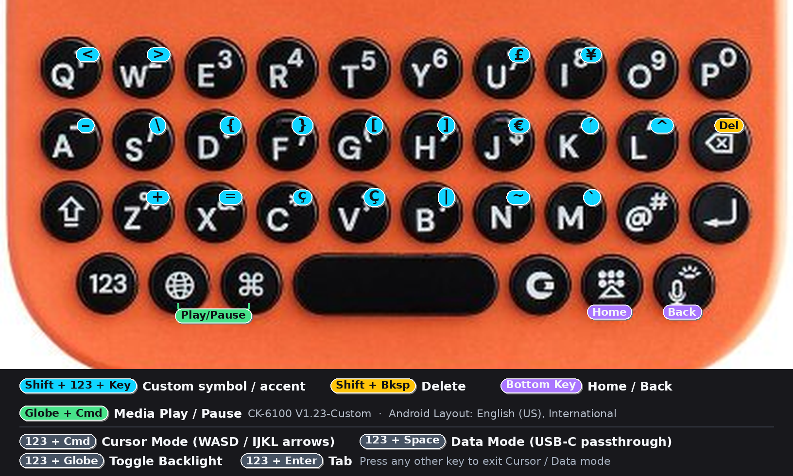

# Note from an actual human: This is vibecoded AI slop that worked for me so I thought it'd be fun to opensource but please don't take it too seriously and use it with care. If you break your clicks, you get to keep both parts. And please don't break your clicks and then go annoy support -- that's super uncool. The clicks folks are awesome and I hope they are successful for a long time!
# P.s.: Clicks folks what about productizing a safer version of this in your app?

# CK-6100 Custom Firmware (`V1.23-Custom`)

Custom firmware patch for the **Clicks Creator Keyboard (`CK-6100`, hardware `3.0.0`)**, built on top of stock `V1.22` (`iKeyboard_CK-6100_V122_300.bin`) and reporting version `1.23`.

Designed for **Android** using the built-in **`English (US), International style`** physical keyboard layout (*Settings → System → Keyboard → Physical keyboard → Clicks Creator Keyboard*).



## Firmware Changes

### USB HID & Endpoint Descriptors
Relocated to `0x6e80` (`94` bytes, down from `97` bytes at `0x6854`) and updated in both `GET_DESCRIPTOR` and `wDescriptorLength`:
- **Modifiers widened (`0xE0..0xE3` → `0xE0..0xE7`):** exposes all 8 modifier bits, enabling `Right Alt / AltGr` (`0x40`).
- **App Grid (`0x01AE`) → `AC Home` (`0x0223`):** acts as Android Home.
- **Mic (`0x00CF`) → `AC Back` (`0x0224`):** acts as Android Back.
- **Added `Play/Pause` (`0x00CD`):** added to the Consumer Report (bit `3` / `0x08`).
- **HID polling interval (`bInterval`: `1 ms` → `8 ms`):** lowered EP `0x81` / `0x01` Interrupt polling from 1000 Hz to 125 Hz (matching the 8 ms matrix scan rate) to reduce active USB host wakeups on Android.

### Key & Combo Remaps
- **`Shift + Backspace` → `Delete`** (`0x4C`, with `Shift` cleared).
- **`Globe + Cmd` → `Media Play/Pause`** (Consumer usage `0x00CD`, replacing `Globe` + `Cmd` when held together).
- **USB-busy key-report retry (`UEP1_TX_CTRL` hardware check):** if USB HID EP1 TX still holds an unread report (`UEP1_TX_CTRL[1:0] == 0` / ACK) when a key press/release occurs, the matrix scanner defers updating EP1 TX and retries every 2 ms (up to 60 ticks / 120 ms) instead of overwriting the unread report.
- **USB Suspend + Remote Wakeup precedence over `accs_stop` (ported from `CA-2200` `V1.1.5`):** when `accs_stop` is enabled and the host has already put USB into Suspend, skip disconnecting USB before `STOP` mode and wake via USB Remote Wakeup instead of forcing a full USB re-enumeration (falling back to disconnect/re-enumerate only if the host did not suspend USB).

### `Shift + 123 + <key>` Layer
| Row | Key | Output | HID Sent |
| --- | --- | --- | --- |
| Top | `Q` | `<` | `Shift + ,` |
| Top | `W` | `>` | `Shift + .` |
| Top | `U` | `£` | `Right Alt + Shift + 4` |
| Top | `I` | `¥` | `Right Alt + -` |
| Home | `A` | `_` | `Shift + -` |
| Home | `S` | `\` | `\` (no `Shift`) |
| Home | `D` | `{` | `Shift + [` |
| Home | `F` | `}` | `Shift + ]` |
| Home | `G` | `[` | `[` (no `Shift`) |
| Home | `H` | `]` | `]` (no `Shift`) |
| Home | `J` | `€` | `Right Alt + 5` |
| Home | `K` | `´` | `'` (no `Shift`, `dead_acute` on US-Intl) |
| Home | `L` | `^` | `Shift + 6` (`dead_circumflex` on US-Intl) |
| Bottom | `Z` | `+` | `Shift + =` |
| Bottom | `X` | `=` | `=` (no `Shift`) |
| Bottom | `C` | `ç` | `Right Alt + ,` |
| Bottom | `V` | `Ç` | `Right Alt + Shift + ,` |
| Bottom | `B` | `\|` | `Shift + \` |
| Bottom | `N` | `~` | `Shift + ` `` ` `` (`dead_tilde` on US-Intl) |
| Bottom | `M` | `` ` `` | `` ` `` (no `Shift`, `dead_grave` on US-Intl) |

## Build

Requires Python 3 (and optionally `capstone` to print disassembled instruction counts). If `iKeyboard_CK-6100_V122_300.bin` is not present in this folder, `build_custom_v123.py` downloads it from upstream, verifies its SHA-256 (`0e33d5132084d31258e1c300cc23e67e73d23179b9d57b03a8d62717a2b725c2`), and outputs `iKeyboard_CK-6100_V123_300_Custom.bin`.

```bash
python3 build_custom_v123.py
```

Options:
- `--no-download`: fail if `iKeyboard_CK-6100_V122_300.bin` is missing.
- `--download`: force re-downloading upstream `V1.22`.

## Flash

`clicks_flash.py` reuses `../clicksctl` (requires `pyusb`) and defaults to a **dry-run**:

```bash
# Offline packet plan check (no USB)
python3 clicks_flash.py --target 1.23-Custom --plan-only

# Dry-run pre-flight against attached CK-6100
python3 clicks_flash.py --target 1.23-Custom

# Flash custom firmware
python3 clicks_flash.py --target 1.23-Custom --flash --confirm CK-6100

# Restore stock V1.22
python3 clicks_flash.py --target 1.22 --flash --confirm CK-6100
```

Use `--serial <serial>` if multiple Clicks devices are attached, or `--image <path>` to flash an arbitrary `.bin` file.
